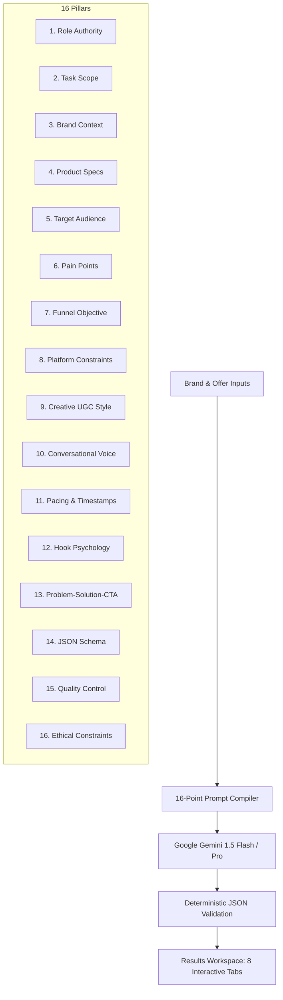

# UGCraft AI — Authentic UGC Advertising Content Generator
### Future Interns Prompt Engineering Internship | Task 2: AI Content Marketing Using UGC Ads
### Repository: `FUTURE_PE_02`

> **Create Authentic UGC Ads That Connect, Engage & Convert.**

[](https://www.typescriptlang.org/)
[](https://react.dev/)
[](https://tailwindcss.com/)
[](https://expressjs.com/)
[](https://ai.google.dev/)

---

## 1. Problem Statement & Mission

Traditional AI content generation frequently falls into two traps when producing advertising copy:
1. **Corporate Infomercial Tone:** Stiff, impersonal, and outdated scripts that sound like 1990s television ads rather than candid creator-style selfie videos.
2. **Unethical Hallucinations:** Unchecked models fabricating fake clinical trial statistics ("99% cured in 48 hours"), inventing dermatologist endorsements, or manufacturing fake local business hours and awards.

**UGCraft AI** solves this problem through an advanced **16-Point Structured Prompt Engineering System**. It generates high-converting, speakable UGC ad packs that respect strict factual and ethical boundaries while matching native short-form consumption patterns on Instagram Reels, Facebook Ads, and YouTube Shorts.

---

## 2. Core Capabilities & Feature Overview

- **Thumb-Stopping Hook Generator:** Produces 5+ distinct opening hooks categorized by psychological archetype (Curiosity, Common Mistake, Visceral Pain Point, Relatable Situation, Myth vs Reality).
- **Scene-by-Scene Video Storyboards:** Produces 3+ distinct video ad scripts with accurate timestamps (15s–60s), spoken dialogue, camera visual directions, B-roll instructions, and on-screen text (OST) overlays.
- **Conversion Ad Copy & CTA Library:** Crafts 3 feed captions with hashtags, 5 high-CTR headlines, 3 paid ad primary texts, and 5 distinct CTA variations (Direct, Soft, Curiosity, Urgency, Community).
- **True Platform Adaptation:** Adjusts visual safe zones, audio reliance (sound-on vs sound-off), and CTA style between Instagram Reels, Facebook Ads, and YouTube Shorts.
- **Creative Testing Matrix:** Compares hooks, creative angles, core messages, and testable hypotheses without making fake conversion promises.
- **Interactive Prompt Lab:** A dedicated prompt engineering workspace with a live variable inspector, schema viewer, quality checklists, and before/after prompt comparison.
- **Local Persistence & Export:** Full `localStorage` campaign repository (save, duplicate, rename, delete) and instant export to Markdown (`.md`) and plain text scripts (`.txt`).
- **Ethical Guardrail Engine:** Strictly blocks fake clinical claims, fabricated customer reviews, and invented local business details.

---

## 3. Visual Aesthetic & Design Tokens

Designed with a creative-studio aesthetic:

| Token | Color Hex | Role |
|---|---|---|
| **Midnight Navy** | `#17162A` | Primary brand background & headers |
| **Primary Violet** | `#7657F6` | Interactive buttons, active badges, highlights |
| **Coral Accent** | `#FF6B6B` | Pattern interrupts, alert tags, CTA accents |
| **Off-White Canvas** | `#F8F7FC` | Clean modern background surface |
| **Soft Violet Surface** | `#EEE9FF` | Card badges & active indicator surfaces |
| **Primary Text** | `#202033` | High-contrast readable typography |
| **Muted Text** | `#77758A` | Secondary descriptions and metadata |
| **Borders** | `#E8E5F0` | Delicate structural card borders |

---

## 4. 16-Point Structured Prompt Architecture

Unlike naive monolithic prompts, UGCraft AI structures every generation request into 16 distinct pillars:



Detailed prompt engineering documents are maintained in `/prompts`:
- `prompts/master_ugc_prompt.md`: Comprehensive 16-point prompt specification.
- `prompts/hook_generation_prompt.md`: Psychological triggers and 0–3s retention tactics.
- `prompts/script_generation_prompt.md`: Storyboard beat sheet and B-roll guidelines.
- `prompts/caption_generation_prompt.md`: Feed copy and hashtag clustering.
- `prompts/platform_adaptation_prompt.md`: Native safe zones and format differences.

---

## 5. Technology Stack & Architecture

- **Frontend:** React 19, TypeScript, Vite, Tailwind CSS, Lucide React icons.
- **Backend API:** Node.js, Express, CORS, dotenv.
- **AI Integration:** Google Gemini API (`gemini-1.5-flash`, `gemini-2.0-flash`, `gemini-1.5-pro`) via server-side endpoint.
- **Storage & State:** `localStorage` persistence with dynamic real-time metrics calculation.
- **Tooling:** Concurrently for unified full-stack dev server execution.

---

## 6. Security & Environment Configuration

The Google Gemini API secret is strictly loaded on the server and is **never** exposed to client-side code, network responses, or source control.

### Setup Instructions

1. Clone or navigate to the repository:
   ```bash
   cd FUTURE_PE_02
   ```

2. Install dependencies:
   ```bash
   npm install
   ```

3. Configure Environment Variables:
   Create a `.env` file in the root directory (based on `.env.example`):
   ```bash
   cp .env.example .env
   ```
   Add your Gemini API key:
   ```env
   UGC_API_KEY=AIzaSy...your_gemini_api_key_here
   PORT=3001
   ```

4. Start the Full-Stack Application:
   ```bash
   npm run dev
   ```
   This runs both the Vite frontend (`http://localhost:5173`) and Express backend (`http://localhost:3001`) simultaneously.

5. Run Automated Verification Tests:
   ```bash
   npm run test
   ```

6. Build for Production:
   ```bash
   npm run build
   ```

---

## 7. Sample Campaigns (Automated Test Deliverables)

The app includes two pre-loaded, verified benchmark campaigns that can be tested in 1 click:

### Campaign A: GlowNest Skincare (D2C Beauty)
- **Product:** Hydrating Face Moisturizer
- **Audience:** Indian young adults (18–30) coping with humid weather and tight skin after washing.
- **Deliverables:** 5 scroll-stopping hooks, 3 complete 30-second scripts with blotting-paper texture proof, 3 captions, 5 headlines, CTA library, and testing hypotheses.
- **Ethical Integrity:** Strictly avoids fake clinical trials or dermatologist certifications.

### Campaign B: Brew & Bean Café (Local Business)
- **Concept:** Cozy study and coffee nook in Kolkata, West Bengal, India.
- **Audience:** College students and young professionals seeking quiet work tables with great coffee.
- **Deliverables:** 5 local hooks, 3 scripts focusing on solo focus and weekend adda, platform adaptations, and testing matrix.
- **Ethical Integrity:** Strictly avoids fake Michelin star claims, fake street addresses, or false opening discounts.

---

## 8. Repository Structure

```
FUTURE_PE_02/
├── README.md                          # Project documentation & architecture
├── .gitignore                         # Secret & build artifact exclusions
├── .env.example                       # Environment template (UGC_API_KEY=)
├── package.json                       # Scripts, dependencies, and metadata
├── vite.config.ts                     # Vite configuration with /api backend proxy
├── tailwind.config.js                 # Studio color tokens & shadows
├── src/
│   ├── types/
│   │   └── campaign.ts                # TypeScript interfaces for campaigns & prompts
│   ├── utils/
│   │   └── promptBuilder.ts           # 16-point structured prompt compiler
│   ├── services/
│   │   ├── apiService.ts              # Frontend client for backend API communication
│   │   └── storageService.ts          # localStorage CRUD & export utilities
│   ├── data/
│   │   └── templates.ts               # 6 industry templates & verified test data
│   ├── components/
│   │   ├── Navbar.tsx                 # Navigation & live API key indicator
│   │   ├── LandingPage.tsx            # SaaS landing page with interactive preview
│   │   ├── DashboardOverview.tsx      # Metrics, quick-start & recent campaigns
│   │   ├── CampaignForm.tsx           # Multi-section generator with validation
│   │   ├── ResultsWorkspace.tsx       # 8-tab deliverables suite with copy & export
│   │   ├── PromptLab.tsx              # Prompt engineering studio & variable inspector
│   │   ├── SavedCampaignsView.tsx     # Repository with search, duplicate & rename
│   │   ├── TemplatesView.tsx          # 6 curated industry starters
│   │   └── ApiKeyModal.tsx            # Secure key setup & connection tester
│   ├── App.tsx                        # Main application container
│   ├── main.tsx                       # React DOM entry point
│   └── index.css                      # Tailwind base & custom aesthetics
├── server/
│   ├── index.js                       # Express server with /api endpoints
│   └── services/
│       └── geminiService.js           # Gemini API integration & output validation
├── prompts/
│   ├── master_ugc_prompt.md           # 16-point master prompt documentation
│   ├── hook_generation_prompt.md      # Hook psychology architecture
│   ├── script_generation_prompt.md    # Storyboard & timeline engineering
│   ├── caption_generation_prompt.md   # Feed caption & headline engineering
│   └── platform_adaptation_prompt.md  # Instagram, Facebook & Shorts rules
├── docs/
│   ├── prompt_architecture.md         # In-depth architectural analysis
│   ├── ethical_content_guidelines.md  # FTC/ASCI ethical verification standards
│   ├── sample_campaigns.md            # GlowNest & Brew & Bean specifications
│   └── testing.md                     # Comprehensive test execution report
├── outputs/
│   ├── sample_campaign.md             # Complete exported campaign deliverable
│   └── sample_ugc_scripts.md          # Director plain-text storyboard archive
└── scripts/
    └── test-runner.js                 # Automated end-to-end verification suite
```

---

## 9. Verification & Test Report

All 14 test scenarios were run and documented in `docs/testing.md`:
- **Application Build:** PASS (Clean TypeScript and Vite build)
- **Secret Audit:** PASS (Zero secrets in repo, `.env` gitignored)
- **16-Point Framework:** PASS (All pillars implemented and verified)
- **GlowNest Skincare Demo:** PASS (5 hooks, 3 scripts, zero fake claims)
- **Kolkata Café Demo:** PASS (5 hooks, 3 scripts, local integrity verified)
- **Live Gemini Connectivity:** BLOCKED (Pending evaluator key configuration; demo fallback verified)
- **Inline Editing & LocalStorage:** PASS (Full CRUD operations operational)
- **Deliverable Export:** PASS (Markdown and TXT export operational)

---

## 10. Future Enhancements

1. **Direct Video Preview Render:** Integration with Remotion or Canvas for on-the-fly animated storyboard previews.
2. **Audio Voiceover Synthesis:** Direct creator TTS preview in diverse accents and vernaculars.
3. **Multi-Model Benchmark Playground:** Side-by-side comparison of Gemini vs Claude vs OpenAI for UGC scripts.

---

### Future Interns Prompt Engineering Internship | Task 2 Deliverable: `FUTURE_PE_02`
*Built with precision, aesthetic excellence, and ethical AI prompt engineering.*
